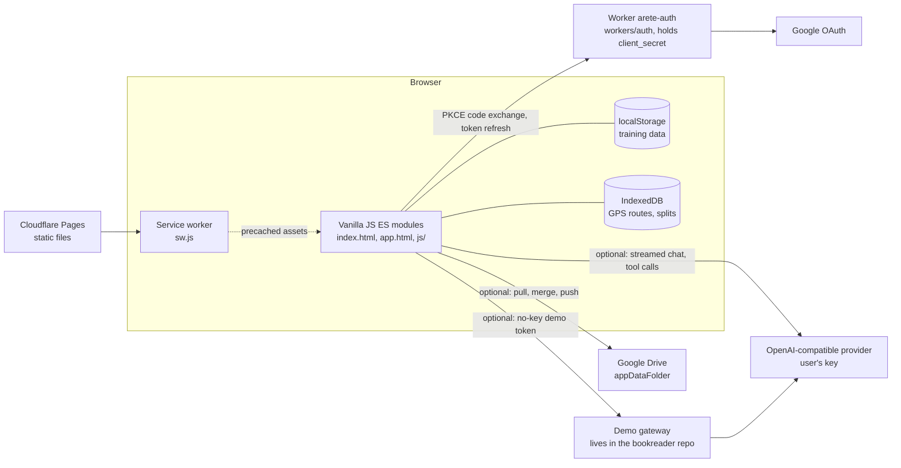

# Areté

Areté is a hybrid strength and endurance training PWA, live at <https://arete.raiatech.com>, by Luis González.
It measures seven performance domains: maximal strength, pulling strength, glycolytic capacity, aerobic endurance, strength endurance, core endurance and functional mobility.
A domain's level is the minimum of its metrics, and the overall level is the minimum of the measured domains; unmeasured domains do not count as zero, they mark the profile `provisional` ([`js/domains.js`](js/domains.js)).

The UI and the internal docs (`AGENTS.md`, `DESIGN_SYSTEM.md`, `docs/`) are in Spanish.

## Architecture

There is no application server and no application database. The app talks directly to Google Drive and to the LLM provider. The only backend code in this repo is a stateless OAuth Worker.



- **Storage.** The training database lives in `localStorage` ([`js/data.js`](js/data.js)). Heavy run data lives in the IndexedDB store `areteRuns` ([`js/run-store.js`](js/run-store.js)).
- **Drive backup and sync** ([`js/drive.js`](js/drive.js), [`js/sync/`](js/sync/)). Optional. It uses the `drive.appdata` scope, so it can only reach the app's own hidden folder.
- **Auth Worker** ([`workers/auth/src/index.js`](workers/auth/src/index.js)). It holds the Google `client_secret`, exposes `/auth/exchange` and `/auth/refresh`, enforces a CORS origin allowlist and stores nothing. The refresh token stays in the browser's `localStorage`; the access token stays in memory ([`js/drive-auth.js`](js/drive-auth.js)).
- **Quirón, the coach agent** ([`js/ai/`](js/ai/)). Optional. Each turn sends a snapshot of the athlete's state to the model, and tool calls execute locally in the browser.

## Stack

| Layer | Technology |
| --- | --- |
| Frontend | Vanilla JavaScript ES modules, HTML, CSS, service worker, Web Worker for background timers |
| Runtime libraries | Three.js (vendored in `js/vendor/three`), Leaflet (loaded on demand from unpkg) |
| npm dependencies | Development only: Vitest, jsdom, Wrangler. No runtime dependencies in `package.json` |
| Hosting | Cloudflare Pages (static), one Cloudflare Worker (`arete-auth`) |
| Integrations | Google Drive API, OpenAI-compatible chat APIs (nan, OpenAI, OpenRouter, Groq or a custom base URL) |
| Offline tooling | Node scripts in `scripts/`, Python scripts in `tools/` for the exercise catalog and media |

## Key engineering decisions

**No build step.** Source files are the files served. Three.js resolves through an import map in `app.html`. [`scripts/build-pages.mjs`](scripts/build-pages.mjs) does not bundle or transform anything: it selects files for deployment.

**Deploys are an allowlist of one pushed commit.** The deploy script extracts `HEAD` with `git archive`, so uncommitted work cannot ship. It refuses a `HEAD` that is not on `origin/main` unless explicitly overridden, and it copies only the entries in its `PUBLIC` list, which keeps tests, evals and notes out of production. The deployed commit is stamped into `/build.json`.

**Design system rules are tests.** `DESIGN_SYSTEM.md` is the doctrine and [`tests/design-system.test.js`](tests/design-system.test.js) enforces it on `app.css`:

- Every `var(--x)` without a fallback must be defined.
- Font sizes, radii, z-indexes and breakpoints must come from the system.
- The count of loose hex colors has a ceiling that can only go down.

The source comments record three non-existent tokens that had left borders transparent and radii square, with no console error.

**Long data must not break layout.** A 70-character exercise name or a 200-character note must not push the document sideways. Tables sit in `.table-scroll`, and values that do not fit step down (`.tile-value--sm`) or wrap. The check uses pathological data at 390 and 320 px and compares `scrollWidth` to the viewport. It is run in a browser and is not part of `npm test`, because jsdom has no layout. Results are logged in [`odd/tasks/auditoria-movil.md`](odd/tasks/auditoria-movil.md).

**The weakest link is the product, so no averages.** Minimums keep a lagging lift from dissolving into a mean. For the same reason, the Epley estimate returns `null` above 12 reps (`REP_CAP`): the derivation keeps the historical maximum, so a single high-rep set could otherwise inflate a domain permanently and hide the real weakness. Thresholds are calibrated for a man of about 75 kg, and the profile screen says so (`CALIBRATION_NOTE`).

**Plan and progression are pure functions of history.** [`js/progression.js`](js/progression.js) and [`js/plan.js`](js/plan.js) store no counters or positions, so correcting a mistyped set fixes the next target immediately and changing a plan needs no migration. The agent reads the same engine through the `get_next_prescription` tool instead of computing loads itself.

**Sync converges through the merge, not through retries.** [`js/sync/merge.js`](js/sync/merge.js) is a union by `uid` with per-item last-write-wins and tombstones, and it is commutative and idempotent. Tests check those properties over 200 seeded random runs. The engine always pulls and merges before pushing, skips no-op pushes, re-merges if the remote changed in between, and takes a Web Lock across tabs. Design notes: [`docs/SYNC-V2.md`](docs/SYNC-V2.md).

**`CACHE_NAME` is the only cache version.** Files have no content hashes and Pages caches JS and CSS for four hours, which once produced a mixed deploy of new HTML and old JS. The service worker therefore precaches with `cache: 'reload'` and fetches same-origin requests with `no-cache`, so a new `CACHE_NAME` really means new code.

**Runs are imported, not tracked.** Browsers throttle `watchPosition` in the background, so the GPS tracker is offered only inside a native Capacitor wrapper ([`js/platform.js`](js/platform.js)); the wrapper itself is not in this repo. On the web, runs come in by GPX or TCX import, parsed with `DOMParser`, or by manual entry ([`js/ui/run-import.js`](js/ui/run-import.js)).

**LLM output is evaluated, and the evaluators are tested.** The eval harness in [`evals/`](evals/) generates against versioned synthetic athletes and checks in a separate step, so tuning a check costs no new LLM calls. The `cifras` check targets this domain's typical hallucination, an invented number. [`tests/evals-checks.test.js`](tests/evals-checks.test.js) tests the checks themselves, because a checker that catches nothing always passes.

## Testing

```bash
npm test             # vitest run, jsdom environment (vitest.config.js)
npm run test:watch   # vitest in watch mode
```

Tests live in [`tests/`](tests/). They cover the domain model, progression, planning, sync (merge, engine, schema), Drive, the AI layer, run import, UI behaviour under jsdom and the design system rules.

Tests that need a personal data export (`evals/fixtures/arete-real.json`, git-ignored) are skipped when the file is absent.

Evals call a real LLM and need `NAN_API_KEY`. Details are in [`docs/EVALS.md`](docs/EVALS.md).

```bash
npm run eval         # generate, then check
npm run eval:smoke   # cheaper subset
npm run eval:check   # re-check the last run without new LLM calls
```

## Run locally

```bash
git clone https://github.com/iamluisgb/arete.git
cd arete
npm ci                   # only needed for tests and deploy tooling
python3 -m http.server   # serves on port 8000
```

Open <http://localhost:8000/index.html> for the landing page or <http://localhost:8000/app.html> for the app. An HTTP server is required because ES modules and service workers do not work from `file://`.

While iterating, the service worker serves cached files. Unregister it and clear caches in DevTools, or use another port.

## Repo layout

```
index.html, app.html     landing page and application shell
app.css, style.css       application styles; blog and content styles
sw.js, manifest.json     service worker and PWA manifest
404.html                 not-found page
js/
  domains.js             seven domains and profile levels (source of truth)
  progression.js         next load for each exercise, with the reason
  plan.js, schedule.js   block position, deloads, weekly queue
  data.js, run-store.js  localStorage and IndexedDB persistence
  drive.js, drive-auth.js  Drive transport and OAuth (PKCE)
  sync/                  merge, sync engine, schema
  ai/                    Quirón: LLM client, context, tools, prompts
  anim3d/                3D exercise animations
  ui/                    screens and components
  vendor/three/          vendored Three.js
workers/auth/            Cloudflare Worker for the OAuth token exchange
auth/                    OAuth popup callback page
programs/, programs.json training programs as JSON
blog/, protocolos/       published articles and protocols
tests/                   Vitest suite
evals/                   LLM eval harness and synthetic fixtures
scripts/                 deploy build, blog sync, social image generation
tools/                   exercise catalog and media generators, layout probe
docs/, odd/              design notes and task logs
AGENTS.md                working rules and rationale for each subsystem
DESIGN_SYSTEM.md         design doctrine
patterns.html            internal live component gallery (not deployed)
```

The other HTML and Markdown files at the root are prototypes and working notes. None of them is in the deploy allowlist.
